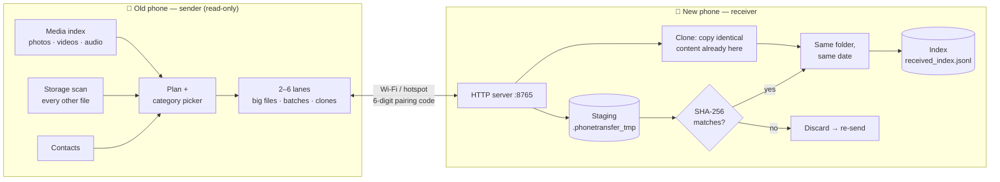
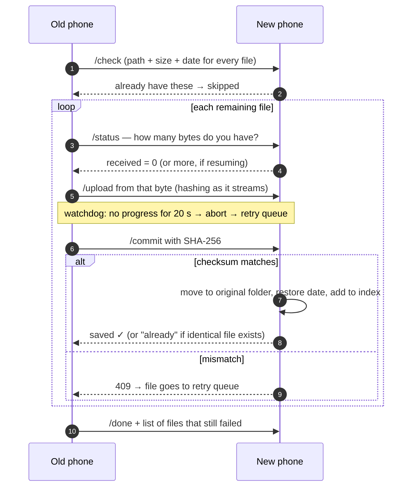
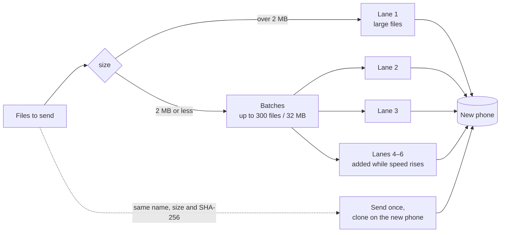
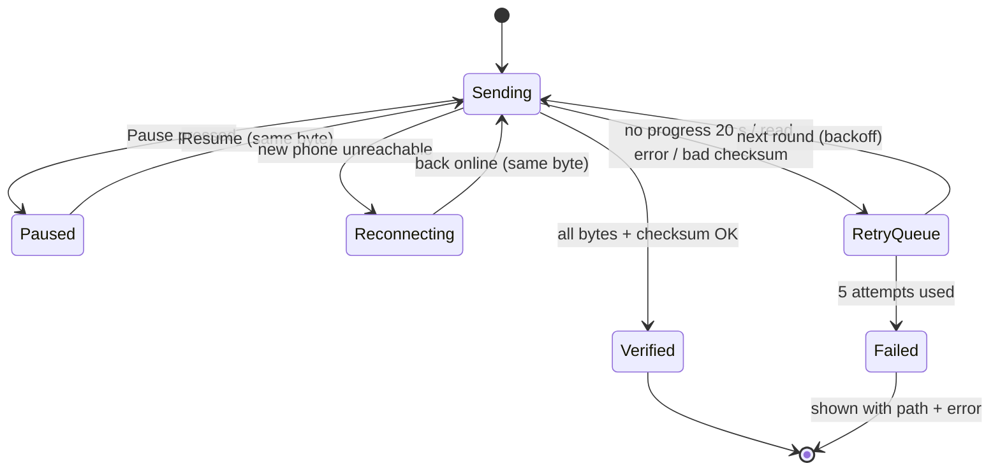
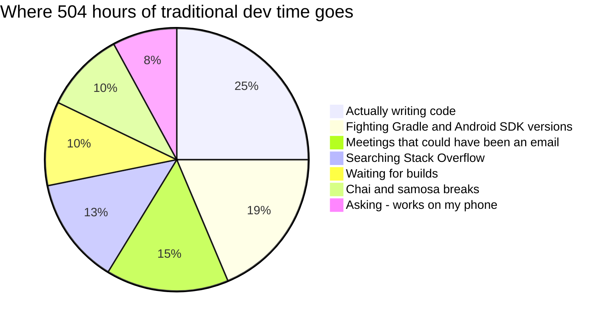

<div align="center">

# 📱➡️📱 Android Phone Clone

### Move *everything* from your old Android phone to your new one — over Wi-Fi, fast, verified, without duplicates.

[](https://github.com/mrajkishor/Android-Phone-Clone/releases/tag/v4.0.0)
[](#-requirements)
[](https://flutter.dev)
[](#-testing)
[](#-privacy--safety)

**[⬇️ Download the APK](https://github.com/mrajkishor/Android-Phone-Clone/releases/tag/v4.0.0)** ·
[Quick start](#-quick-start) ·
[Features](#-features) ·
[How it works](#-how-it-works) ·
[FAQ](#-faq) ·
[Changelog](CHANGELOG.md)

</div>

---

## 📑 Table of contents

- [Why v4?](#-why-v4)
- [Features](#-features)
- [Quick start](#-quick-start)
- [Upgrading from v3](#%EF%B8%8F-upgrading-from-v3)
- [What gets transferred](#-what-gets-transferred)
- [The transfer screen, explained](#-the-transfer-screen-explained)
- [How it works](#-how-it-works)
- [Speed: how v4 goes faster](#-speed-how-v4-goes-faster)
- [Reliability: timeouts, retry queue, resume](#-reliability-timeouts-retry-queue-resume)
- [No duplicates — the index](#-no-duplicates--the-index)
- [Privacy & safety](#-privacy--safety)
- [Permissions](#-permissions)
- [Requirements](#-requirements)
- [Build from source](#-build-from-source)
- [Testing](#-testing)
- [Project structure](#-project-structure)
- [Version history](#-version-history)
- [The Claude effect](#-the-claude-effect-a-totally-scientific-analysis)
- [FAQ](#-faq)
- [Troubleshooting](#-troubleshooting)
- [Known limitations](#-known-limitations)
- [Author & contributors](#-author--contributors)

---

## 🚀 Why v4?

This app was built in four rounds. Each version fixed real gaps found in the one before it, and **v4 contains everything from v1, v2 and v3**:

| | **v1** — *It works* | **v2** — *It's exact* | **v3** — *It's unstoppable* | **v4** — *It's fast* |
|---|:---:|:---:|:---:|:---:|
| Photos, videos, music, contacts | ✅ | ✅ | ✅ | ✅ |
| QR-code pairing over local Wi-Fi | ✅ | ✅ | ✅ | ✅ |
| Documents & other files | ✋ picked by hand | ✅ found automatically | ✅ | ✅ |
| Same folders as the old phone | ❌ flattened | ✅ | ✅ | ✅ |
| Original photo/video dates | ❌ reset to today | ✅ | ✅ | ✅ |
| SHA-256 checksum on every file | ❌ | ✅ | ✅ | ✅ in background threads |
| No duplicates on re-runs | ❌ | ✅ index | ✅ index + content check | ✅ |
| Progress | file count | bytes, %, speed, ETA | live per-file bytes | **every file in flight** |
| Timeouts & retry queue (DLQ) | ❌ | ❌ | ✅ exponential backoff | ✅ |
| Pause / resume | ❌ | ❌ | ✅ from the exact byte | ✅ |
| Survives Wi-Fi drops & app close | ❌ | ❌ | ✅ | ✅ |
| **Files in flight at once** | 1 | 1 | 1 | **2–6, adapts to your Wi-Fi** |
| **Small files** | one request each | one request each | one request each | **up to 300 per request** |
| **Identical files in two folders** | sent twice | sent twice | sent twice | **sent once, copied on the new phone** |
| **Media index updates** | after every file | after every file | after every file | **in batches** |
| **Continue without scanning again** | ❌ | ❌ | ❌ | ✅ one tap |
| **Update mid-transfer** | — | — | — | ✅ from v3, picks up where it paused |
| End report | counts | per-category table | 🎉 or failed-file list | 🎉 or failed-file list + speed-ups |

> [!NOTE]
> In short: **v1** proved the idea, **v2** made every copy exact and duplicate-free, **v3** made long transfers survive timeouts, Wi-Fi drops, pauses and the app being closed, and **v4** makes it **several times faster**, especially for phones full of photos and small files. Full details are in the [CHANGELOG](CHANGELOG.md).

---

## ✨ Features

<table>
<tr>
<td width="50%" valign="top">

### 🔍 Finds everything
Scans the whole phone automatically and groups files into **Photos, Videos, Music, Documents, Archives, APKs, Other media, Other files** and **Hidden files**. Each group shows a count and size, with an on/off switch.

### 🗂️ Exact copies
Every file lands in **the same folder** with **the same modified date** it had on the old phone. Every file is **SHA-256 verified** before it's kept.

### 🚫 No duplicates
A persistent **index** on the new phone remembers what already arrived. Running again — after a stop, a crash or a reinstall — never creates copies.

### 👤 Contacts done right
Contacts arrive with all their fields and **full-size photos**. Contacts already on the new phone are skipped.

</td>
<td width="50%" valign="top">

### 📊 Live, byte-level progress
See the **file name, folder and bytes in flight** (*"12.4 MB of 56 MB"*), updated ~10× a second, plus overall %, speed, time left and recently finished files.

### ⏸️ Pause & resume
Pause in the middle of a 4 GB video. Resume continues **from the exact byte** where it stopped.

### 🔁 Self-healing
A file that stalls for 20 s is skipped and put in a visible **retry queue**. It's retried after the other files with **exponential backoff**. If Wi-Fi drops, the app **waits and reconnects** automatically.

### 🌙 Runs in the background
Press Home, Back, or swipe the app away. The transfer keeps going, with progress in the notification.

</td>
</tr>
<tr>
<td colspan="2" valign="top">

### ⚡ Fast *(new in v4)*
**2–6 files in flight at once**, tuned automatically to your Wi-Fi. **Small files travel in batches** of up to 300 per request. **Identical files are sent once** and copied on the new phone. Checksums run in background threads, and Android's media index is updated in batches. Typical gain for a phone full of photos: **3–8× faster than v3**.

</td>
</tr>
</table>

---

## ⚡ Quick start

> [!IMPORTANT]
> Install **v4** on **both** phones for full speed. v4 still works with a phone on v3, but then sends one file at a time.

1. **Download** `PhoneTransfer-v4.0.0.apk` from the [v4.0.0 release](https://github.com/mrajkishor/Android-Phone-Clone/releases/tag/v4.0.0) (or [`apk/`](apk/)) and install it on both phones.
2. **Connect** both phones to the same Wi-Fi. *No Wi-Fi?* Turn on **hotspot on the new phone** and join it from the old one.
3. **New phone:** open the app → **This is the NEW phone** → allow *All files access*. A QR code appears.
4. **Old phone:** open the app → **This is the OLD phone** → allow *All files access* → **scan the QR code**.
5. **Choose** what to send, tap **Start transfer**, and relax. 🎉

> [!TIP]
> **Fastest setup:** turn on the **new phone's hotspot** (5 GHz if your phone offers it), join it from the old phone, and keep the phones next to each other.

<details>
<summary><b>📷 Camera not working? Pair manually</b></summary>

<br>

Under the QR code, the new phone shows an **address** (e.g. `192.168.1.5:8765`) and a **6-digit code**. On the old phone, tap **Enter address and code instead** and type both.

</details>

<details>
<summary><b>📲 How do I install an APK?</b></summary>

<br>

1. Open the downloaded `.apk` file on the phone.
2. If Android asks, allow **Install unknown apps** for your browser or file manager.
3. If Play Protect warns that the app isn't from the Play Store, tap **More details → Install anyway**.

</details>

---

## ⬆️ Upgrading from v3

**Yes, you can update in the middle of a transfer.** Nothing already sent is re-sent, and a half-sent file continues from the byte where it stopped.

1. On the old phone, tap **⏸ Pause**. (Even if you don't, nothing is lost.)
2. Install **v4** on **both** phones. It installs over v3 as an update, because it's signed with the same key, and the app's data is kept.
3. Open the app on both phones: **NEW phone** on one, **OLD phone** on the other.
4. **Scan the QR code once.** v3 didn't remember the pairing; v4 does, so from now on you'll see **Continue previous transfer** instead.
5. Tap **Start transfer**. Finished files are skipped, and half-sent files resume from the same byte.

| Kept across the update | How |
|---|---|
| Everything already received | v4 reads v3's **index** (and v2's too) |
| Half-sent files | Same hidden staging folder and same file IDs, so they resume from the exact byte |
| Your category choices | Pick them again once; v4 remembers them from then on |
| Retry queue | Not kept (it lived in memory), so those files are simply tried again |

<details>
<summary><b>Only updated one phone?</b></summary>

<br>

That works too. The QR code stays readable by v3, and both directions are supported:

| Old phone | New phone | What happens |
|---|---|---|
| v4 | v4 | ⚡ Fast mode: parallel lanes, batches, cloning |
| v4 | v3 | Compatibility mode: one file at a time, everything else as in v3 |
| v3 | v4 | Works exactly like v3 → v3 |

The app shows which mode it's in while sending.

</details>

---

## 📦 What gets transferred

| Category | What's in it | Default |
|---|---|:---:|
| 🖼️ **Photos** | Everything in the gallery | ✅ |
| 🎬 **Videos** | Everything in the gallery | ✅ |
| 🎵 **Music & audio** | Songs, recordings, other audio | ✅ |
| 📄 **Documents** | PDF, Word, Excel, PowerPoint, text, CSV, e-books… | ✅ |
| 🗜️ **Archives** | ZIP, RAR, 7z, TAR… | ✅ |
| 📦 **App installers** | APK files saved on the phone | ✅ |
| 🎞️ **Other media** | Pictures, videos and audio the gallery doesn't show | ✅ |
| 📁 **Other files** | Anything else on internal storage or an SD card | ✅ |
| 🙈 **Hidden files** | Files in hidden folders — mostly caches and thumbnails | ⬜ |
| 👤 **Contacts** | All fields + full-size photos; existing contacts skipped | ✅ |

<details>
<summary><b>❌ What can't be transferred (and why)</b></summary>

<br>

Android reserves these for system tools such as Google's setup restore or Samsung Smart Switch. A regular app is not allowed to read or write them:

| Not transferred | Alternative |
|---|---|
| Installed apps and their data | Google account restore during phone setup |
| SMS / MMS, call history | Google One backup, or your phone maker's tool |
| WhatsApp & other in-app chat histories | The app's own backup (e.g. WhatsApp → Chats → Chat backup) |
| Wi-Fi passwords, settings, wallpapers | Google account restore |
| `Android/data` and `Android/obb` folders | Private to each app by design |

</details>

---

## 🖥️ The transfer screen, explained

```text
┌──────────────────────────────────────────────┐
│ ⬆  Sending                                   │  ← status: Sending / Paused /
│    You can leave the app…                    │    Waiting for the new phone /
├──────────────────────────────────────────────┤    Retrying — round 2 of 4
│ 42%                     1.9 GB of 4.5 GB     │
│ ████████████░░░░░░░░░   18.2 MB/s • 3 min    │  ← overall progress + ETA
│ 512 of 1,240 files                           │
│ 37 already on the new phone — skipped        │
├──────────────────────────────────────────────┤
│ 📄 VID_20240611_181502.mp4                   │  ← the file in flight,
│    DCIM/Camera                               │    byte by byte
│ ███████████████░░░░░░░  412 MB of 610 MB 67% │
│ Continued from 120 MB                        │  ← resumed, not restarted
├──────────────────────────────────────────────┤
│ Just finished                                │
│ ✓ IMG_20240611_181455.jpg          3.1 MB    │
│ ✓✓ invoice_march.pdf          already there  │
├──────────────────────────────────────────────┤
│ ⟳ Retry queue (1)                            │  ← the DLQ, always visible
│   ⏱ backup.zip — Download/                   │
│     Tried 1 of 5 · Timed out: no progress…   │
├──────────────────────────────────────────────┤
│   [ ⏸ Pause ]            [ ⏹ Stop ]          │
└──────────────────────────────────────────────┘
```

When it finishes, you get one of two endings:

<table>
<tr>
<th>✅ Everything arrived</th>
<th>⚠️ Some files couldn't be sent</th>
</tr>
<tr>
<td valign="top">

```text
            🎉
          Hurray!
 Everything was transferred

 1,203 files copied, 37 were
 already there, 412 contacts.
 Every file checksum-verified.
```

</td>
<td valign="top">

```text
 ⚠ 2 file(s) could not be transferred
 /storage/emulated/0/Download/big.iso
   → Timed out: no progress for 20 s
 /storage/emulated/0/Docs/locked.pdf
   → Could not read the file: Permission denied

 [ Copy list ]   [ Try the failed files again ]
```

</td>
</tr>
</table>

---

## 🔬 How it works

Both phones run the same app. The **new phone** runs a small HTTP server on the local network, and the **old phone** connects to it using the address and pairing code from the QR code. Nothing goes through the internet.



### One file's journey



<details>
<summary><b>🔌 Protocol reference (v4)</b></summary>

<br>

Every request carries the 6-digit pairing code in an `X-Code` header. The QR code carries `v: 3` (so v3 phones can still read it) and `max: 4`. `/ping` reports the version actually spoken, and the old phone uses fast mode only when both phones speak `4`.

| Endpoint | Purpose |
|---|---|
| `GET /ping` | Connection and version check |
| `POST /check` | Which files (key = `path\|size\|mtime`) the index already has |
| `POST /hello` | Start of a session: totals to expect |
| `POST /state` | Heartbeat from the old phone every second (progress, paused, retry queue) |
| `POST /contacts` | A batch of 50 contacts; duplicates skipped |
| `GET /status?id=` | Bytes already received for a file (for resume) |
| `POST /upload?id&offset&total&name` | Streams bytes from `offset` into the staging file |
| `POST /commit` | Verify SHA-256, move into place, restore date, add to index |
| `POST /batch?count&total` *(v4)* | Many small files in one stream: `[4-byte length][header JSON with SHA-256][bytes]` per file; each is verified and saved as it arrives |
| `POST /clone` *(v4)* | "You already have this content (SHA-256): copy it to this path" — no bytes sent |
| `POST /done` | End of session + final failed-file list |

</details>

---

## ⚡ Speed: how v4 goes faster



| Technique | What it does | Helps most with |
|---|---|---|
| **Parallel lanes** | 3 lanes to start; every 4 s one is added while speed keeps rising (up to 6), and one is removed on stalls or errors (down to 2) | Everything: the Wi-Fi never sits idle waiting for a reply |
| **Separate lane for large files** | Lane 1 takes files over 2 MB; the others take small-file batches | A 4 GB video no longer blocks thousands of photos queued behind it |
| **Small-file batches** | Up to 300 files (32 MB) per request instead of ~3 round trips per file | Photos, documents, WhatsApp media |
| **Duplicate cloning** | Files with the same name, size and SHA-256 are sent once; the new phone copies the others locally | The same picture saved in two folders |
| **Background checksums** | SHA-256 runs in worker isolates, so the main thread only moves bytes and the screen stays smooth | High speeds |
| **Batched media indexing** | The new phone tells Android about new files 200 at a time, every 2 s, instead of waiting after each file | Large numbers of files |
| **1 MB reads** | Fewer, larger socket writes | Large files |

**Not used: compression.** Photos, videos and music are already compressed, so it would only burn CPU and battery.

> [!NOTE]
> Every v3 guarantee still holds in fast mode. Each file is SHA-256 verified, nothing is duplicated, pause and resume work per file, and a stalled file — even one inside a batch — goes to the retry queue on its own while the rest of its batch carries on.

---

## 🛡️ Reliability: timeouts, retry queue, resume



| Situation | What the app does |
|---|---|
| ⏱️ **A file makes no progress for 20 s** | Aborts it, puts it in the **retry queue**, and moves on to the next file. Inside a batch, only the stuck file is queued; files already saved are kept and the rest of the batch is re-sent |
| 🔁 **Retry queue** | Runs after all other files, in rounds of **5 s → 10 s → 20 s → 40 s** (±20% jitter), up to **5 attempts** per file |
| 📶 **The new phone drops off Wi-Fi** | *Not* a file failure: shows "Waiting for the new phone…" and re-checks with backoff (2 s → 4 s → 8 s → 15 s) until it's back |
| ⏸️ **You press Pause** | Stops mid-file; the 20 s timeout doesn't count while paused |
| ▶️ **You press Resume** / a retry starts | Asks the new phone how many bytes it has and **continues from there** |
| ⏹️ **You press Stop**, the app is killed, or the phone restarts | Half-sent files stay in the staging folder; the next run skips finished files and continues partial ones |
| 🧮 **A checksum doesn't match** | The damaged copy is discarded and the file goes to the retry queue |
| 🌙 **App in the background or swiped away** | A foreground service (with CPU and Wi-Fi locks) keeps the transfer running; tapping the notification brings you back to it |

<details>
<summary><b>⚙️ Exact numbers</b></summary>

<br>

| Setting | Value |
|---|---|
| Stall timeout (sender) | 20 s without a byte moving |
| Idle timeout (receiver) | 60 s without a byte arriving |
| Attempts per file | 5 (1 + 4 retry rounds) |
| Retry round delays | 5 s, 10 s, 20 s, 40 s × random 0.8–1.2 |
| Reconnect checks | 2 s, 4 s, 8 s, then every 15 s |
| Commit timeout | 60 s + 1 s per 20 MB (time to checksum large files) |
| Quick re-sync on byte mismatch | up to 3 times, then retry queue |
| Parallel lanes *(v4)* | start 3, min 2, max 6, adjusted every 4 s |
| Batch size *(v4)* | files ≤ 2 MB, up to 300 files or 32 MB per batch |
| Duplicate check *(v4)* | files ≥ 64 KB sharing a name and size |
| Media index updates *(v4)* | every 2 s or 200 files |

</details>

---

## 🧾 No duplicates — the index

The new phone keeps a persistent **index** of everything it has received:

```text
key  = relative path | size | modified time     e.g. DCIM/Camera/IMG_1.jpg|3145728|1559644200000
value = { saved location, SHA-256 }
```

1. **Before sending**, the old phone sends the keys of all selected files. The new phone answers with the ones already in the index whose file still exists. Those are **skipped without sending a byte**.
2. **If the index is lost** (app reinstalled, data cleared), the new phone still checks before saving: a file with the **same name *and* the same SHA-256** is reported as *already there* and isn't written again.
3. **A *different* file with the same name** is never overwritten. The incoming one is saved beside it as `name (1).ext`.
4. **A repeated commit** (for example, the reply got lost on the network) is recognised from the index and doesn't create a copy.

Contacts use their own check: phone numbers (last 10 digits), email addresses, or the name for contacts with neither.

---

## 🔒 Privacy & safety

- 🏠 **Local only.** Data travels directly between the two phones over your Wi-Fi or hotspot. There's no cloud, account or internet connection involved.
- 🔑 **Paired.** Every request needs the 6-digit code shown on the new phone.
- 👀 **The old phone is read-only.** The sending code only reads files. It contains no write, move or delete operations on the old phone, and the tests verify the old side is byte-for-byte unchanged.
- ⚠️ Traffic is plain HTTP inside your local network. Use a network you trust, such as your home Wi-Fi or the new phone's own hotspot.

---

## 🔐 Permissions

| Permission | Phone | Why |
|---|---|---|
| **All files access** | both | Old: find and read every file. New: put each file back in its original folder |
| Photos, videos, audio | old | Read Android's media index |
| Contacts | both | Read on the old phone, add on the new phone |
| Camera | old | Scan the pairing QR code |
| Notifications | both | Show progress while running in the background |
| Foreground service, wake lock | both | Keep the transfer running with the screen off |
| Network / Wi-Fi state | both | Local connection between the phones |

---

## 📋 Requirements

- Two Android phones running **Android 7.0 (API 24) or newer**
- Both on the **same Wi-Fi**, or the old phone joined to the new phone's **hotspot**
- Enough free space on the new phone

---

## 🛠️ Build from source

```bash
git clone https://github.com/mrajkishor/Android-Phone-Clone.git
cd Android-Phone-Clone
flutter pub get
flutter test                 # 10 end-to-end tests
flutter build apk --release  # → build/app/outputs/flutter-apk/app-release.apk
```

<details>
<summary><b>Toolchain used for v4.0.0</b></summary>

<br>

| Tool | Version |
|---|---|
| Flutter | 3.47 (stable) |
| Android Gradle Plugin | 9.1 |
| Gradle | 9.3 |
| compileSdk / targetSdk / minSdk | 37 / 36 / 24 |
| Java | 21 |

The release APK is signed with the debug key, which is fine for sideloading. Set up your own keystore before publishing anywhere. Google Play reviews apps that use *All files access*; device-to-device transfer is one of its permitted uses.

</details>

---

## 🧪 Testing

`test/transfer_test.dart` runs the **real sender against the real receiver** over a local socket, with Android's native calls simulated:

| # | Scenario | Proves |
|:-:|---|---|
| 1 | Scan a sample storage tree | Every file found and classified; private folders and stale media entries skipped |
| 2 | Full transfer, then re-run twice | Exact copies (paths, bytes, dates); old phone unchanged; re-runs and a lost index create **no duplicates**; same-name different file saved as `name (1)` |
| 3 | Stop halfway, then continue | Everything arrives **exactly once** |
| 4 | A file stalls on the first try | Skipped → retry queue → **recovered after all other files** |
| 5 | A file vanishes after the scan | Ends in the **final failed list** with its full path and error |
| 6 | Pause mid-file, then resume | Stays paused (no timeout), **continues from the same byte**, file identical |
| 7 | QR code compatibility | A v3 phone can still read a v4 QR code; a v4 phone sees version 4 |
| 8 | 450+ small files, 2 large files, an identical picture in two folders | **Several lanes in flight**, **2+ batches**, the duplicate **cloned** instead of re-sent, every file exact |
| 9 | Update from v3 mid-transfer | v2/v3 index records honoured; a half-sent v3 file **resumes from byte 1,000,000**; nothing duplicated |
| 10 | New phone still on v3 | v4 falls back to **one file at a time** and still copies everything exactly |

```bash
flutter test
# 00:07 +10: All tests passed!
```

---

## 🗺️ Project structure

<details>
<summary><b>Show the tree</b></summary>

<br>

```text
lib/
├── main.dart                       # Home: "This is the NEW / OLD phone"
├── screens/
│   ├── permission_gate.dart        # "All files access" prompt
│   ├── scan_screen.dart            # QR scanner + manual pairing
│   ├── send_screen.dart            # Old phone: categories, live progress, results
│   ├── receive_screen.dart         # New phone: QR code, live progress, results
│   ├── transfer_widgets.dart       # Progress cards, retry queue, 🎉 / failed list
│   └── report_table.dart           # Copied / already there / failed table
└── transfer/
    ├── protocol.dart               # Categories, pairing, SHA-256 streaming, formatting
    ├── scanner.dart                # Finds and classifies every file (background isolate)
    ├── sender.dart                 # Upload engine: lanes, batches, resume, watchdog, retry queue
    ├── receiver.dart               # HTTP server: staging, verify, index, batches, clones, contacts
    ├── session_store.dart          # Remembers the last transfer for one-tap "Continue"
    └── native.dart                 # Bridge to Android (storage, media index, service)
android/app/src/main/kotlin/com/example/phone_transfer/
├── App.kt                          # Owns the Flutter engine → survives app close
├── MainActivity.kt                 # Re-attaches to the running engine
├── NativeBridge.kt                 # Storage roots, media index, file dates, service control
└── TransferService.kt              # Foreground service + notification + wake/Wi-Fi locks
test/transfer_test.dart             # End-to-end tests
apk/PhoneTransfer-v4.0.0.apk        # Ready-to-install build (v3.0.0 kept alongside)
```

</details>

---

## 🕰️ Version history

| Version | Theme | Highlights | ⏱️ Build time |
|---|---|---|:---:|
| [**v4.0.0**](https://github.com/mrajkishor/Android-Phone-Clone/releases/tag/v4.0.0) · *latest* | Fast | 2–6 adaptive lanes, small-file batches, duplicate cloning, background checksums, batched media indexing, one-tap Continue, update from v3 mid-transfer | **~15 min** |
| [v3.0.0](https://github.com/mrajkishor/Android-Phone-Clone/releases/tag/v3.0.0) | Unstoppable | Live per-file bytes, retry queue with backoff, pause/resume, byte-level resume, reconnect, background running | **~16 min** |
| v2.0.0 | Exact | Automatic file detection, same folders & dates, SHA-256, index, contact dedupe | **~14 min** |
| v1.0.0 | It works | Photos, videos, music, contacts, hand-picked files over Wi-Fi with QR pairing | **~43 min** |

### ⏱️ How long it took

The whole app went from idea to v4 release on **8 November 2026**, built in conversation between [@mrajkishor](https://github.com/mrajkishor) and Claude. Times are measured from each request to the finished, installable APK (IST):

| Version | Requested | APK ready | Build time | What the time went into |
|---|:---:|:---:|:---:|---|
| **v1.0.0** | 12:25 | 13:08 | **~43 min** | First code base (~10 min). Then setting up the Flutter & Android SDKs, upgrading plugins to current versions, and fixing build issues to produce the first APK |
| **v2.0.0** | 15:20 | 15:34 | **~14 min** | Automatic file detection, checksum + commit protocol, index, same folders & dates, contact dedupe, new screens, first end-to-end tests. *Preceded by a ~15 min review of v1 (from 15:03) that found the gaps v2 fixes* |
| **v3.0.0** | 15:49 | 16:05 | **~16 min** | Resumable uploads, stall watchdog, retry queue with backoff, pause/resume, reconnect, background service, live per-file progress, 3 new tests |
| **Repo & docs** | 16:57 | 17:15 | **~18 min** | This repository, README, CHANGELOG, release notes and the release workflow |
| **v4.0.0** | 17:50 | 18:04 | **~15 min** | Parallel adaptive lanes, small-file batches, duplicate cloning, background checksums, batched media indexing, v3 compatibility both ways, update-mid-transfer, one-tap Continue, 4 new tests |

```mermaid
gantt
    title Build timeline — 8 Nov 2026 (IST)
    dateFormat HH:mm
    axisFormat %H:%M
    section v1
    Code + first APK          :done, v1, 12:25, 43m
    section v2
    Review of v1              :done, r1, 15:03, 17m
    Build v2                  :done, v2, 15:20, 14m
    section v3
    Build v3                  :done, v3, 15:49, 16m
    section Repo
    GitHub repo + docs        :done, gh, 16:57, 18m
    section v4
    Build v4                  :done, v4, 17:50, 15m
```



> **Total hands-on build time: ~1 h 46 min** (v1 + v2 + v3 + repo + v4). The gaps in between were spent discussing requirements and reviewing each version.

Full details: **[CHANGELOG.md](CHANGELOG.md)**

---

## 💸 The Claude effect *(a totally scientific analysis)*

> [!WARNING]
> Every number below was calculated using the industry-standard methodology known as **"vibes."** No spreadsheets were harmed. Please don't send this to your CFO.

### 🧑‍💻 The team that *would* have built this

| Role | Traditional estimate | Actual |
|---|---|---|
| Senior Flutter developer | 7.5 weeks | 😴 on leave (didn't need to come back) |
| Android native developer (Kotlin, services, MediaStore) | 3 weeks | 🏖️ still at the beach |
| Intern | 7.5 weeks, mostly asking "why is Gradle red?" and "what's an isolate?" | 🎓 promoted to *Chief APK Installer* (2 phones, 1 tap each) |
| QA engineer | 2 weeks | 🤖 replaced by 10 tests that pass while you sip chai |
| Technical writer | 3 days | 📝 this README wrote itself (with help) |
| Scrum master | 38 stand-ups × 15 min | 🪑 the chair is still warm |
| **Product owner / boss / visionary** | — | 👑 **[@mrajkishor](https://github.com/mrajkishor), very much employed** |

**Jobs actually lost: 0.** The intern was reassigned to holding both phones during testing, which is honestly the most important job here. 📱🤲📱

### ⏱️ Hours saved

| | Old-school team | With Claude |
|---|:---:|:---:|
| v1.0.0 — *It works* | ~80 h | 43 min |
| v2.0.0 — *It's exact* | ~120 h | 14 min |
| v3.0.0 — *It's unstoppable* | ~160 h | 16 min |
| Repo, README, CHANGELOG, release | ~24 h | 18 min |
| v4.0.0 — *It's fast* | ~120 h | 15 min |
| **Total** | **~504 person-hours** (≈ 12.5 work-weeks) | **~1 h 46 min** |

That's roughly **285× faster**, or, put another way, Claude finished four versions before a typical team would have finished arguing about whether to use `provider` or `riverpod`.

### 💰 Money saved

| Line item | Old-school cost (₹) |
|---|---:|
| Senior Flutter dev — 300 h × ₹1,200 | 3,60,000 |
| Android native dev — 120 h × ₹1,200 | 1,44,000 |
| Intern — 300 h × ₹150 | 45,000 |
| QA — 80 h × ₹600 | 48,000 |
| Tech writer — 24 h × ₹800 | 19,200 |
| Chai ☕ (4 people × 2 cups × 63 days × ₹15) | 7,560 |
| Samosas for "quick sync" meetings 🥟 | 5,600 |
| Emergency pizza on release nights (×2) 🍕 | 6,400 |
| **Total** | **≈ ₹6,36,000** *(≈ US$ 7,500)* |
| **Actual cost** | **One Claude subscription and a bit of patience** |

### 📊 Where those 12.5 weeks would *really* have gone



### 🏆 Fun facts from this build

| Stat | Value |
|---|---|
| Lines committed in the first push | ~5,200 |
| Versions shipped in one afternoon | 4 |
| Gradle build failures defeated | 6 *(Maven rate limit, SDK mismatch, plugin APIs, out of memory… we've seen things)* |
| End-to-end tests | 10, all passing — every time |
| Times the internet "dropped" mid-build | 1 *(it hadn't; v4 carried on from the same checkpoint)* |
| Merge conflicts | 0 |
| Jira tickets created | 0 |
| "Can you hop on a quick call?" | 0 |
| Times a human said *"Is it possible?"* and the answer was yes | Many |
| Chai consumed by Claude | 0 (it's a language model; it's sad about this) |

> [!NOTE]
> **The honest bit:** a human still made every decision that mattered — what to build, what "done" means, what to fix next — and the app still needs testing on real phones by real people. Claude just did the typing. Very, *very* fast typing. ⚡

---

## ❓ FAQ

<details>
<summary><b>How long does it take?</b></summary>

<br>

It depends on your Wi-Fi. On a typical home router, expect roughly **10–30 MB/s**; on the new phone's **5 GHz hotspot** with the phones close together, often **30–60 MB/s**. At that speed, **50 GB takes about 15–30 minutes**. With v4 on both phones, that holds even for phones full of small files. The app shows the live speed and time left.

</details>

<details>
<summary><b>Can I update the app in the middle of a transfer?</b></summary>

<br>

Yes, from v3 to v4 and onwards. Pause, install the update on both phones, open the app on both, and continue. See [Upgrading from v3](#%EF%B8%8F-upgrading-from-v3).

</details>

<details>
<summary><b>Can I use the phones during the transfer?</b></summary>

<br>

Yes. Press Home or Back and the transfer continues in the background, with progress in the notification. Avoid turning off Wi-Fi or hotspot.

</details>

<details>
<summary><b>What happens if I stop halfway?</b></summary>

<br>

Nothing is lost. Start again from the old phone: files already on the new phone are skipped, and a half-sent file continues from where it stopped.

</details>

<details>
<summary><b>Will my photos show the right dates in the gallery?</b></summary>

<br>

Yes. Each file keeps its original modified date, and photos and videos keep their embedded capture date, so the gallery timeline looks the same as on the old phone.

</details>

<details>
<summary><b>My contacts sync with Google. Will they be doubled?</b></summary>

<br>

No. Before adding a contact, the new phone checks for an existing one with the same phone number or email and skips it.

</details>

<details>
<summary><b>Is the old phone changed in any way?</b></summary>

<br>

No. The app only reads files on the old phone. Nothing is moved, edited or deleted.

</details>

---

## 🩺 Troubleshooting

<details>
<summary><b>"Couldn't reach the new phone"</b></summary>

<br>

- Make sure both phones are on the **same** Wi-Fi network (not a guest network that isolates devices).
- Or turn on the **hotspot on the new phone** and connect the old phone to it.
- Keep the new phone's app open on the QR screen while pairing.

</details>

<details>
<summary><b>The transfer stops when the screen is off or the app is in the background</b></summary>

<br>

Some phone makers (Xiaomi, Oppo, Vivo, Realme, Samsung with strict battery saving) close background apps aggressively. Go to **Settings → Apps → Phone Transfer → Battery** and choose **Unrestricted**, on **both** phones. Anything already sent is kept, and the next start resumes.

</details>

<details>
<summary><b>A file keeps failing</b></summary>

<br>

It will appear in the final list with its full path and error. Tap **Copy list** and move those files manually (USB cable or memory card), or tap **Try the failed files again** later.

</details>

<details>
<summary><b>"The new phone has an older version of this app"</b></summary>

<br>

v4 works with v3 phones in compatibility mode. This message only appears with much older versions (v1/v2): install v4.0.0 on both phones.

</details>

---

## ⚠️ Known limitations

- Android 15 limits this kind of background service to **6 hours per day**.
- Fast mode needs **v4 on both phones**; with a v3 phone, files go one at a time.
- Plain HTTP on the local network, protected by the pairing code only. There's no end-to-end encryption yet.
- A file that changes after the scan (e.g. still downloading) is reported as failed. Scan again to include the new version.
- Background running and automatic reconnect are designed for real devices and have **not been tested** on physical phones in the automated suite.

## 👤 Author & contributors

<table>
<tr>
<td align="center">
<a href="https://github.com/mrajkishor">
<br>
<b>@mrajkishor</b>
</a><br>
<sub>Creator & maintainer · product owner</sub>
</td>
<td align="center">
<a href="https://claude.ai">
<br>
<b>Claude</b>
</a><br>
<sub>Co-author · code, tests, docs</sub>
</td>
</tr>
</table>

Ideas, bug reports and pull requests are welcome. Open an [issue](https://github.com/mrajkishor/Android-Phone-Clone/issues) to get started.

---

<div align="center">

Made with Flutter 💙 · [Report an issue](https://github.com/mrajkishor/Android-Phone-Clone/issues) · [Releases](https://github.com/mrajkishor/Android-Phone-Clone/releases)

</div>
