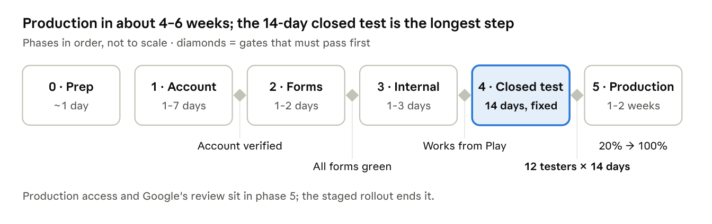

# PhoneHop — Production Rollout Checklist

*As of 14 Nov 2026 · Owner: Rajkishor Maharana*

## Overview

Ship **4.2.2 (standard permissions)** to production first, in about **4–6 weeks**; bring the 5.x features (messages, call history) in a later update. Most of the time is Google's fixed waits: identity checks, the 14-day closed test and reviews.

|  |  |
| --- | --- |
| App name | **PhoneHop** |
| Package (application ID) | `com.mrajkishor.phoneclone`, permanent |
| First Play build | 4.2.2 (version code 8), signed with the upload key |
| Account type | New personal developer account (needs the 12-tester closed test) |
| Ready-made answers | `docs/play-store/` in the repo: `listing.md`, `declarations.md`, graphics, `PRIVACY.md` |

**Who does what:** **You** = steps only the account owner can do (identity, payment, legal submit, real testers, final promote). **Claude** = can fill forms in your signed-in browser (you approve each submit), build/upload via GitHub Actions, monitor and fix. Tick each box as you go.

Each phase starts only when the gate before it has passed; the closed test can't be shortened.

## Phase 0 · Before Play Console (start today, ~1 day)

The build, key and listing assets are already done; what's left is backups and finding testers early.

- [x] Unique package `com.mrajkishor.phoneclone`, app name PhoneHop, target SDK 36
- [x] Upload signing key created (`phone-clone-upload.jks` + `key.properties`), never committed to git
- [x] Privacy policy (`PRIVACY.md`), store listing text, 512×512 icon, 1024×500 feature graphic
- [x] Release `.aab` for 4.2.2 (version code 8) built and verified
- [ ] **You:** back up the upload key and passwords in a password manager + one offline copy
- [x] Privacy policy at a public URL: <https://github.com/mrajkishor/Android-Phone-Clone/blob/main/PRIVACY.md> (checked: loads without sign-in)
- [ ] **You:** create a support email address for the listing (or use your own)
- [ ] **You:** start collecting **12+ testers' Gmail addresses** now (friends, family, colleagues); aim for 15 so a drop-out doesn't reset the clock. Ready-to-send invite: [`tester-invite.md`](tester-invite.md). Keep the addresses out of this public repo.
- [ ] **You:** keep two Android phones ready for testing and for recording the permission videos
- [x] **Claude:** GitHub Actions workflow to build, sign and upload to Play: [`.github/workflows/play-upload.yml`](../../.github/workflows/play-upload.yml). Runs only when started by hand (or a `play-v*` tag) and stops with a clear message until the secrets exist

## Phase 1 · Developer account and app (1 hour + 1–7 days verification)

Only you can do this phase: Google verifies you as a person.

- [ ] **You:** create the developer account at play.google.com/console → **Personal** → pay the US$25 one-time fee
- [ ] **You:** complete identity verification (government ID) and verify your phone number and email
- [ ] **You:** verify access from a real Android device if Play Console asks (the Play Console app)
- [ ] Wait for the "account verified" email (usually 1–7 days)
- [ ] **You:** Create app → name **PhoneHop** → default language English (India or US) → **App** → **Free** → accept the declarations
- [ ] **You:** keep **Play App Signing** on the default (Google holds the app signing key; your upload key signs uploads)
- [ ] **You:** Google Cloud: create a **service account**, then in Play Console → Users and permissions, invite it with *Release* rights; save its JSON key
- [ ] **You:** add five GitHub secrets (Settings → Secrets and variables → Actions): `PLAY_SERVICE_ACCOUNT_JSON`, `UPLOAD_KEYSTORE_BASE64` (`base64 -w0 phone-clone-upload.jks`), `UPLOAD_STORE_PASSWORD`, `UPLOAD_KEY_PASSWORD`, `UPLOAD_KEY_ALIAS`
- [ ] **Claude:** run *Upload to Google Play* with ref `1b57aa6` (4.2.2), track `internal`, status `draft`

## Phase 2 · Store listing and policy forms (1–2 days)

Claude fills each form in your signed-in browser from `docs/play-store/`; you review and press Submit. Every item below must be green before any release can go out.

**Store listing** (Grow → Store presence → Main store listing)

- [ ] App name, short description (80 chars), full description (4,000 chars) from `listing.md`
- [ ] App icon 512×512 and feature graphic 1024×500 from `docs/play-store/graphics/`
- [ ] Phone screenshots: 2–8 real-phone captures, taken during internal testing (Phase 3)
- [ ] Category **Tools**, contact email, privacy policy URL

**App content** (Policy → App content)

- [ ] Privacy policy URL
- [ ] App access: *All functionality available without special access* (no login)
- [ ] Ads: *No ads*
- [ ] Content rating questionnaire (category Utility/Tools) → expect *Everyone / 3+*
- [ ] Target audience: 18+ (avoids the Families policy)
- [ ] News app: No
- [ ] Data safety: per `declarations.md` (files and contacts handled on-device, nothing collected or shared, data encrypted in transit over the local network only)
- [ ] Government app: No · Financial features: none · Health: none

**Sensitive permission declarations** (with videos recorded on a real phone)

- [ ] **All files access** (`MANAGE_EXTERNAL_STORAGE`): use case *Device migration / phone transfer* + a 30–60 s video of choosing folders and copying
- [ ] **Foreground service** (*dataSync*): the transfer keeps running in the background; video of the notification during a transfer
- [ ] **Install apps** (`REQUEST_INSTALL_PACKAGES`) — only for a 5.x build; not needed for 4.2.2
- [ ] **You:** press Submit on each declaration after checking it

## Phase 3 · Internal testing (1–3 days)

Prove the Play-signed build works on real phones before anyone else sees it.

- [ ] **Claude:** upload `PhoneHop 4.2.2` (version code 8) to the **Internal testing** track via GitHub Actions
- [ ] **You:** add yourself and 1–2 helpers as internal testers; open the opt-in link on both phones
- [ ] **You:** install from Play on the old and new phone (uninstall any sideloaded copy first: different signing key)
- [ ] **You:** run a full transfer: QR pairing, photos, videos, documents, contacts, pause/resume, background
- [ ] **You:** take the 2–8 store screenshots and record the permission videos here
- [ ] **Claude:** check Android vitals and the pre-launch report for crashes; fix and re-upload if needed (raise the version code each time)

## Phase 4 · Closed testing: 12 testers for 14 days (≥ 14 days, fixed)

Required for new personal accounts before production access; the 14-day clock runs only while 12 or more testers stay opted in.

- [ ] **Claude:** promote the same build to a **Closed testing** track (e.g. *Alpha*), countries: India (+ any others)
- [ ] **You:** add the 12–15 testers' Gmail addresses to the tester list; share the opt-in link (Claude can draft the WhatsApp/email message)
- [ ] **Testers:** open the link → *Become a tester* → install from Play → keep it installed and open it a few times
- [ ] **You:** confirm Play Console shows **12+ opted-in testers**; note the start date: day 14 = earliest production-access date
- [ ] **You:** ask testers for feedback (what was confusing, what broke); Claude fixes and ships updates to the closed track
- [ ] Don't remove testers or let the count drop below 12 during the 14 days, or the clock restarts

## Phase 5 · Production access and release (~1–2 weeks)

Apply on day 14, then release to production with a staged rollout you control.

**Apply for production access** (Dashboard → *Apply for production*)

- [ ] **Claude:** draft the answers: how testers were recruited, what feedback came in and what changed, why the app is ready
- [ ] **You:** review and submit; wait for Google's decision (usually up to ~7 days)
- [ ] If refused: read the reason, extend the closed test or fix what's asked, re-apply

**Production release**

- [ ] **Claude:** create the production release with the latest tested build + release notes (English, and Hindi/Odia if you want)
- [ ] **You:** set countries (India first, or worldwide) and confirm the release; it goes to Google's review (1–7 days; longer with sensitive permissions)
- [ ] **You:** start a **staged rollout at 20%**
- [ ] **Claude:** watch crash rate, ANRs and reviews for 2–3 days; recommend go / halt
- [ ] **You:** raise to 50%, then **100%** if the numbers stay healthy (Play's bad-behaviour thresholds: user-perceived crash rate 1.09%, ANR rate 0.47%)
- [ ] **You:** check the public listing on a phone that isn't a tester: search *PhoneHop*, install, transfer once

## Phase 6 · After launch (ongoing)

Automate the routine; keep the decisions with you.

- [ ] **Claude:** daily GitHub Action posts a report (crash/ANR rates, new reviews, rollout status) as a GitHub issue
- [ ] **Claude:** weekly scheduled task reads the reports, opens PRs with fixes, drafts review replies for you to approve
- [ ] **You:** reply to reviews (or approve Claude's drafts) within a few days
- [ ] **You:** keep target SDK current: Google's yearly deadline is usually **31 August**
- [ ] **You:** renew/confirm developer account details when Play Console asks; keep the privacy policy URL live
- [ ] **Claude:** each new version: raise the version code, update `CHANGELOG.md`, release notes, internal → closed → production with a staged rollout
- [ ] Optional: add Play In-App Updates and In-App Review to the app

## Releasing v5 (restricted permissions) later

Ship v5 to Play only after 4.2.2 is live; split it so a refusal of SMS/call log can't block the rest.

- [ ] **Claude:** make a Play build of 5.x **without** SMS and call-log permissions (Messages and Call history switches show as unavailable); everything else stays
- [ ] **You:** declare *Install apps* (`REQUEST_INSTALL_PACKAGES`) as *Device migration / phone transfer*, with a video
- [ ] Ship that build through internal → closed → production (staged)
- [ ] Optional: apply for SMS and call log under the *Backup and restore* exception with a video; expect a manual review and possible refusal
- [ ] Keep the full 5.x APK (with Messages and Call history) on GitHub Releases for sideloading; install over USB to avoid the Play Protect block
